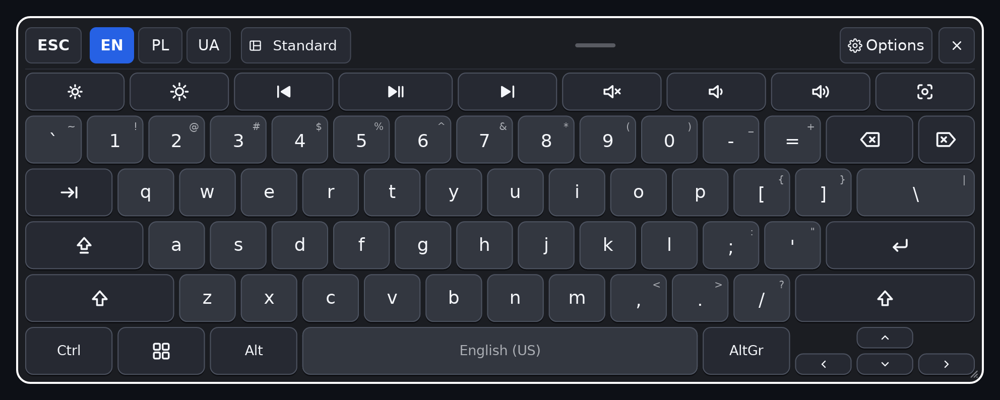
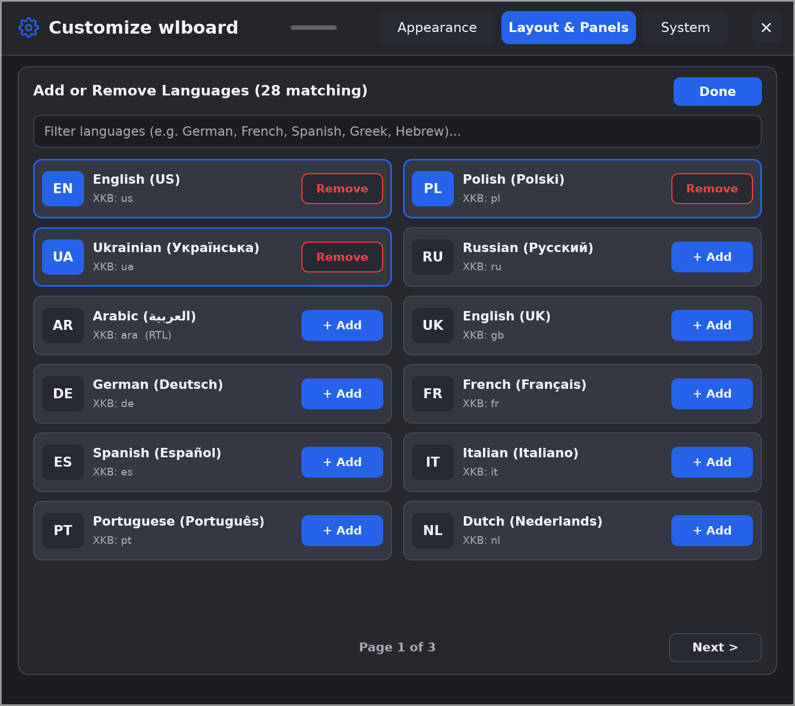
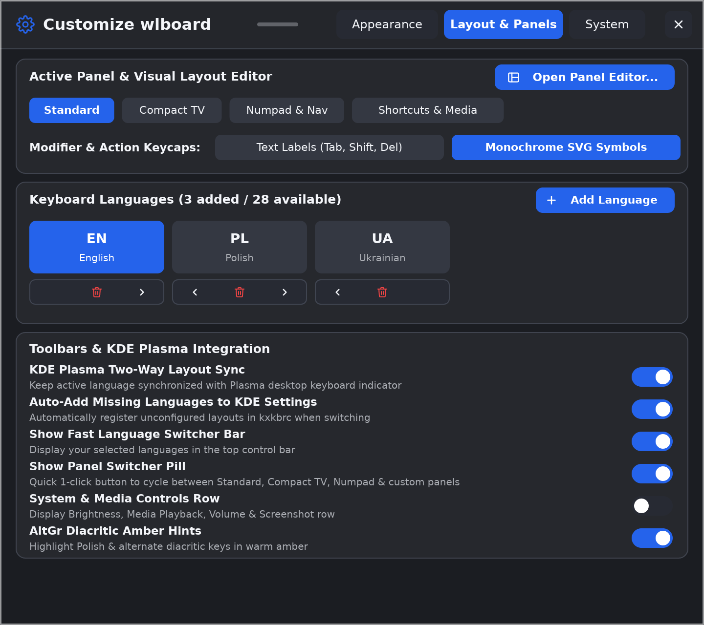
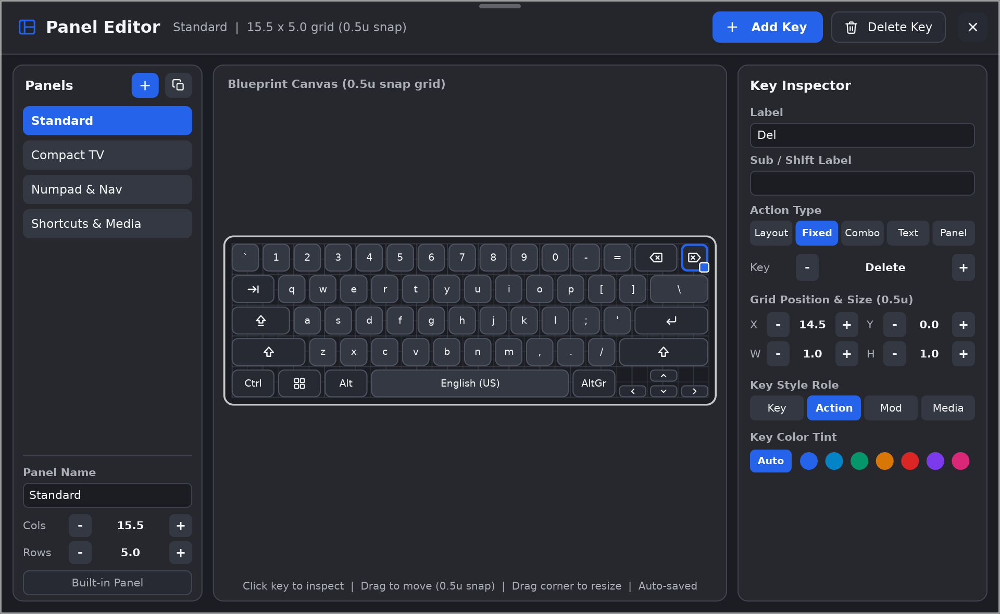

# wlboard

**wlboard** is a lightweight, deeply customizable native Wayland virtual keyboard and custom panel studio written in Rust.

Built directly on `smithay-client-toolkit`, `tiny-skia`, `cosmic-text`, and `resvg`, it renders crisp anti-aliased keycaps and monochrome vector icons with zero GTK, Qt, or GPU-driver dependencies.

## Highlights

- **Dual-Mode Wayland Support (Floating Desktop Overlay + KDE Lockscreen & SDDM Login Screen)**:
  - **Floating Overlay (`wlboard --toggle`)**: Uses `zwlr_layer_shell_v1` (`Layer::Overlay`, `KeyboardInteractivity::None`) so the keyboard stays above windows without stealing focus on **KDE Plasma**, **Hyprland**, and **Sway**, with smooth drag, 8-edge resize, and automatic display-bounds clamping.
  - **Native Input Method (`wlboard --input-method`)**: Implements `zwp_input_method_v1` + `zwp_input_panel_v1` (`set_toplevel` at `CenterBottom`), installs `io.github.olekkut.wlboard-im.desktop` (`X-KDE-Wayland-VirtualKeyboard=true`), and includes a **1-click KDE Lockscreen setup** button inside **Customize wlboard → System** (plus the `wlboard-sddm-kwin` wrapper for SDDM Wayland) so the virtual keyboard works reliably on both touchscreens and mouse/VM setups.
- **28 Built-in Languages + Searchable Add/Delete Language Manager**: Add, remove, or reorder any language directly inside **Customize wlboard → Layout & Panels** from 28 built-in layouts (English US/UK, Polish, Ukrainian, Russian, Arabic, German, French, Spanish, Italian, Portuguese, Dutch, Czech, Slovak, Hungarian, Romanian, Croatian, Turkish, Swedish, Norwegian, Danish, Finnish, Greek, Bulgarian BDS, Belarusian, Lithuanian, Hebrew, Persian) with HarfBuzz/BiDi shaping, optional AltGr amber diacritic hints, two-way KDE Plasma D-Bus sync, and automatic `kxkbrc` layout registration.
- **Built-in Visual Panel Editor (`0.5u` Snap Grid)**: Design, duplicate, and customize keyboard panels visually with drag-to-move, corner-handle resize, and a full Key Inspector supporting layout keys, fixed keys, multi-key shortcuts (`Ctrl+C`, `Alt+Tab`, `Super+D`), text snippets, panel switchers, and per-key color tints.
- **4 Starter Panels + Quick Panel Switcher**: Switch instantly between **Standard** (with half-height Inverted-T arrows and forward `Del`), **Compact TV** (`ABC` + `123` / `F1–F12` / Navigation), **Numpad & Nav**, and **Shortcuts & Media**, plus your own custom JSON panels (`~/.config/wlboard/panels/*.json`).
- **Keycap Style Toggle**: Choose between crisp **Text Labels** (`Tab`, `Caps`, `Shift`, `Return`, `Del`) or clean **Monochrome SVG Symbols**.
- **Automatic Input Injection & True Multi-Touch Chording**: Native `zwp_input_method_v1` (`commit_string` + `keysym`) in Lockscreen/IM mode, `zwp_virtual_keyboard_v1` on Hyprland/Sway, and pure-Rust `/dev/uinput` fallback with a **250 ms stuck-key watchdog** on KDE Plasma desktop. Full `wl_touch` chording lets you hold `Shift`, `Ctrl`, `Alt`, or `AltGr` with one finger while tapping keys with another.
- **Draggable & 8-Edge Resizable Settings & Panel Editor Windows**: 4 theme bases (**Graphite Dark** with crisp white outline border, **Frost Light**, **High Contrast TV**, **Slate**), quick accent swatches, an inline HSV/Hex color picker for all 7 color slots, border/opacity/font/radius/spacing sliders, and saveable JSON **User Presets**. Drag either option window effortlessly from its header bar or empty chrome, and resize from any edge or corner.
- **Native System Tray & Instant CLI**: Built-in `StatusNotifierItem` + D-Bus menu tray icon with dynamic language and panel switching plus single-instance D-Bus IPC (`wlboard --toggle`, `wlboard --settings`, `wlboard --panel-editor`).

---

## Screenshots

### Graphite Dark — Standard Layout (Inverted-T Arrows, Forward `Del`, Monochrome SVG Symbols & Media Row)


### Built-in Settings — Searchable 28-Language Add / Remove Picker


### Built-in Settings — Layout, Panels & Active Languages Manager


### Built-in Settings — System & 1-Click KDE Lockscreen Setup


### Built-in Visual Panel Editor (3-Pane `0.5u` Snap-Grid Studio)


### Starter Panels — Shortcuts & Media and Numpad & Nav


### Graphite Dark — Compact for TV (Ukrainian)


### Frost Light — Polish Layout with AltGr Amber Diacritic Hints


### Custom User Preset ("Midnight Cyan") — Arabic Layout


### Built-in Customize wlboard — Appearance & HSV Color Slots


---

## Installation

### Ubuntu / Kubuntu / Debian (`.deb` Package — `amd64`)

Install the latest prebuilt `.deb` package (automatically installs the `/dev/uinput` udev rule, KDE Plasma virtual keyboard desktop entry, and SDDM helper):

```bash
curl -fsSL -o /tmp/wlboard.deb https://raw.githubusercontent.com/olekkut/wlboard/deb-build/wlboard_0.3.0-1_amd64.deb \
  && sudo apt install -y /tmp/wlboard.deb \
  && rm -f /tmp/wlboard.deb
```

### Build from Source

Requires Rust 1.89+ (`cargo`):

```bash
git clone https://github.com/olekkut/wlboard.git
cd wlboard
cargo build --release
sudo install -Dm755 target/release/wlboard /usr/bin/wlboard
sudo install -Dm755 packaging/deb/wlboard-im /usr/bin/wlboard-im
sudo install -Dm644 packaging/deb/io.github.olekkut.wlboard.desktop /usr/share/applications/io.github.olekkut.wlboard.desktop
sudo install -Dm644 packaging/deb/io.github.olekkut.wlboard-im.desktop /usr/share/applications/io.github.olekkut.wlboard-im.desktop
sudo install -Dm644 assets/io.github.olekkut.wlboard.svg /usr/share/icons/hicolor/scalable/apps/io.github.olekkut.wlboard.svg
```

On **KDE Plasma Wayland** desktop (where `/dev/uinput` fallback is used in floating overlay mode), run once to grant local session access to `/dev/uinput`:

```bash
./packaging/deb/setup-uinput.sh
```

---

## KDE Plasma Lockscreen & SDDM Login Screen Setup

### KDE Plasma Lockscreen (One Click inside wlboard)

1. Open **Customize wlboard → System** (`wlboard --settings`).
2. Click **Enable KDE Lockscreen (Mouse + Touch)**.
   - This automatically registers `io.github.olekkut.wlboard-im.desktop` in `~/.config/kwinrc` (`[Wayland]`) and writes `~/.config/environment.d/70-wlboard-kwin.conf` (`KWIN_IM_SHOW_ALWAYS=1`) so KWin displays the virtual keyboard on both touchscreens and mouse/VM systems when you click **Virtual Keyboard** on the lockscreen.
3. Log out and log back in once so Plasma's KWin session picks up `KWIN_IM_SHOW_ALWAYS=1`.
4. Lock your screen (`Super+L`) and click the **Virtual Keyboard** button!

*(Prefer touch-only automatic behavior? Click **Switch to Touch-Only** right beside it in the System tab.)*

### Optional: SDDM Wayland Login Screen

To also enable `wlboard` on the SDDM Wayland login screen before logging in, run the bundled helper script:

```bash
/usr/share/wlboard/scripts/setup-sddm.sh
```

This writes `/etc/sddm.conf.d/70-wlboard.conf` pointing `CompositorCommand` to `/usr/share/wlboard/scripts/wlboard-sddm-kwin`, which exports `KWIN_IM_SHOW_ALWAYS=1`, unsets legacy `QT_IM_MODULE`/`GTK_IM_MODULE` overrides, and starts `kwin_wayland --inputmethod /usr/bin/wlboard-im`. To revert at any time:

```bash
/usr/share/wlboard/scripts/setup-sddm.sh --remove
```

---

## Usage & CLI

| Command | Action |
|---|---|
| `wlboard` | Start `wlboard` floating overlay (or bring an existing instance to front) |
| `wlboard --toggle` | Toggle visibility (bind this to a panel button or compositor shortcut) |
| `wlboard --settings` | Open the built-in **Customize wlboard** window |
| `wlboard --panel-editor` | Open the built-in **Panel Editor** studio |
| `wlboard --panel <id>` | Switch active panel (`standard`, `compact_tv`, `numpad_nav`, `shortcuts_media`, or custom ID) |
| `wlboard --layout <code>` | Switch active language layout (any of the 28 built-in codes such as `en`, `pl`, `uk`, `ru`, `ar`, `de`, `fr`, `es`, `it`, `el`, `he`, `fa`, etc.) |
| `wlboard --input-method` | Run as a Wayland `zwp_input_method_v1` / `zwp_input_panel_v1` virtual keyboard (launched automatically by KWin on Lockscreen/SDDM) |
| `wlboard --hide` | Hide the floating overlay |
| `wlboard --quit` | Release all keys and exit cleanly |

### Configuration & User Data

- Settings file: `~/.config/wlboard/config.toml`
- Saved Custom Panels: `~/.config/wlboard/panels/*.json`
- Saved User Presets: `~/.config/wlboard/presets/*.json`
- Custom Layout Overrides: `~/.config/wlboard/layouts/*.json`

---

## Workspace Architecture

| Crate | Purpose |
|---|---|
| `crates/wlboard-core` | Pure Rust domain model: unified 2D `0.5u` snap-grid panel model, 4 starter panels + JSON `PanelStore`, 28 built-in international layouts + custom JSON overrides, modifier & Sticky Lock state machine, theme palette/contrast math, TOML config, JSON User Presets, multi-touch & 8-edge resize geometry |
| `crates/wlboard-platform` | OS & desktop adapters: `zwp_input_method_v1` direct Unicode/keysym backend, `zwp_virtual_keyboard_v1` + dynamic XKB keymap compiler, pure-Rust `evdev` uinput + 250 ms watchdog, KDE Plasma two-way D-Bus layout sync + automatic `kxkbrc` layout registration + 1-click KWin lockscreen setup, StatusNotifierItem tray, single-instance D-Bus IPC |
| `crates/wlboard-ui` | Unified `tiny-skia` + `cosmic-text` + `resvg` renderer, dual-mode `zwlr_layer_shell_v1` / `zwp_input_panel_v1` keyboard surface, draggable & resizable 3-pane visual Panel Editor window, draggable & resizable live-themed `Customize wlboard` window, offline HiDPI PNG preview generator |
| `crates/wlboard-app` | Thin CLI binary (`wlboard`), logging, IPC dispatch, and `SIGINT`/`SIGTERM` clean key-release shutdown |

---

## License

Copyright (C) 2026 Aleksander Kutycki (`olekkut`).

Licensed under the **GNU General Public License v3.0 or later** (`GPL-3.0-or-later`). See [LICENSE](LICENSE) for full terms.
