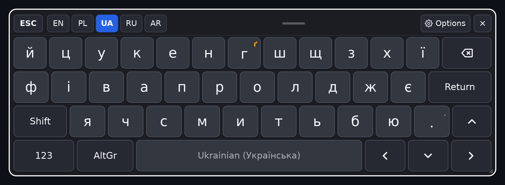

# wlboard

**wlboard** is a lightweight, deeply customizable native Wayland floating virtual keyboard written in Rust.

Built directly on `smithay-client-toolkit`, `tiny-skia`, `cosmic-text`, and `resvg`, it renders crisp anti-aliased keycaps and monochrome vector icons with zero GTK, Qt, or GPU-driver dependencies.

## Highlights

- **Floating Non-Focus-Stealing Wayland Overlay**: Uses `zwlr_layer_shell_v1` (`Layer::Overlay`, `KeyboardInteractivity::None`) so the keyboard stays above other windows without ever stealing input focus on **KDE Plasma**, **Hyprland**, and **Sway**.
- **Smooth Drag & 8-Edge Resize**: Drag the top bar to reposition freely, or resize from any edge, corner, or the bottom-right grip with automatic typography and icon scaling.
- **Automatic Input Injection**:
  - Uses Wayland's native `zwp_virtual_keyboard_v1` automatically on **Hyprland** and **Sway** with dynamically compiled XKB keymaps for every layout.
  - Falls back automatically to pure-Rust Linux `/dev/uinput` (`evdev`) with a **250 ms stuck-key watchdog** and guaranteed release-all on hide, cancel, or `SIGINT`/`SIGTERM` on **KDE Plasma Wayland**.
- **True Multi-Touch Chording**: Native `wl_touch` contact tracking lets you hold `Shift`, `Ctrl`, `Alt`, or `AltGr` with one finger while tapping keys with another.
- **Multi-Language Support + Two-Way Plasma Sync**: Built-in **English (`EN`)**, **Polish (`PL`)**, **Ukrainian (`UA`)**, **Russian (`RU`)**, and **Arabic (`AR`)** layouts with HarfBuzz/BiDi shaping, fast language switcher bar, optional AltGr amber diacritic hints, and two-way KDE Plasma D-Bus layout synchronization (`org.kde.keyboard`).
- **Standard & Compact for TV Modes**: Switch between a full 5-row desktop layout and a large, couch-readable **Compact for TV** mode (`ABC` + `123` / `F1–F12` / Navigation).
- **Built-in Settings & User Presets Window**: Live-themed `Customize wlboard` window featuring 4 theme bases (**Graphite Dark** with crisp white outline border, **Frost Light**, **High Contrast TV**, **Slate**), quick accent swatches, an inline HSV/Hex color picker for all 7 color slots, border/opacity/font/radius/spacing sliders, and saveable JSON **User Presets**.
- **Native System Tray & Instant CLI**: Built-in `StatusNotifierItem` + D-Bus menu tray icon and single-instance D-Bus IPC (`wlboard --toggle`, `wlboard --settings`).

---

## Screenshots

### Graphite Dark — Standard Layout & System/Media Row


### Graphite Dark — Compact for TV (Ukrainian)


### Frost Light — Polish Layout with AltGr Amber Diacritic Hints


### Custom User Preset ("Midnight Cyan") — Arabic Layout


### Built-in Customize wlboard Settings & Presets Window


---

## Installation

### Ubuntu / Kubuntu / Debian (`.deb` Package — `amd64`)

Install the latest prebuilt `.deb` package (automatically installs the `/dev/uinput` udev rule for KDE Plasma Wayland):

```bash
curl -fsSL -o /tmp/wlboard.deb https://raw.githubusercontent.com/olekkut/wlboard/deb-build/wlboard_0.1.0-1_amd64.deb \
  && sudo apt install -y /tmp/wlboard.deb \
  && rm -f /tmp/wlboard.deb
```

### Build from Source

Requires Rust 1.89+ (`cargo`):

```bash
git clone https://github.com/olekkut/wlboard.git
cd wlboard
cargo build --release
sudo install -Dm755 target/release/wlboard /usr/bin/wlboard
sudo install -Dm644 packaging/deb/io.github.olekkut.wlboard.desktop /usr/share/applications/io.github.olekkut.wlboard.desktop
sudo install -Dm644 assets/io.github.olekkut.wlboard.svg /usr/share/icons/hicolor/scalable/apps/io.github.olekkut.wlboard.svg
```

On **KDE Plasma Wayland** (where `/dev/uinput` fallback is used), run once to grant local session access to `/dev/uinput`:

```bash
./packaging/deb/setup-uinput.sh
```

---

## Usage & CLI

| Command | Action |
|---|---|
| `wlboard` | Start `wlboard` (or bring an existing instance to front) |
| `wlboard --toggle` | Toggle visibility (bind this to a panel button or compositor shortcut) |
| `wlboard --settings` | Open the built-in **Customize wlboard** window |
| `wlboard --layout pl` | Switch active layout (`en`, `pl`, `uk`, `ru`, `ar`) |
| `wlboard --hide` | Hide the floating overlay |
| `wlboard --quit` | Release all keys and exit cleanly |

### Configuration & User Data

- Settings file: `~/.config/wlboard/config.toml`
- Saved User Presets: `~/.config/wlboard/presets/*.json`
- Custom Layout Overrides: `~/.config/wlboard/layouts/*.json`

---

## Workspace Architecture

| Crate | Purpose |
|---|---|
| `crates/wlboard-core` | Pure Rust domain model: JSON layouts, Standard & Compact TV builders, modifier & Sticky Lock state machine, theme palette/contrast math, TOML config, JSON User Presets, multi-touch & 8-edge resize geometry |
| `crates/wlboard-platform` | OS & desktop adapters: `zwp_virtual_keyboard_v1` + dynamic XKB keymap compiler, pure-Rust `evdev` uinput + 250 ms watchdog, KDE Plasma two-way D-Bus layout sync, StatusNotifierItem tray, single-instance D-Bus IPC |
| `crates/wlboard-ui` | Unified `tiny-skia` + `cosmic-text` + `resvg` renderer, floating `zwlr_layer_shell_v1` keyboard overlay, built-in themed `xdg_toplevel` Settings & Presets window, offline PNG preview generator |
| `crates/wlboard-app` | Thin CLI binary (`wlboard`), logging, IPC dispatch, and `SIGINT`/`SIGTERM` clean key-release shutdown |

---

## License

Copyright (C) 2026 Aleksander Kutycki (`olekkut`).

Licensed under the **GNU General Public License v3.0 or later** (`GPL-3.0-or-later`). See [LICENSE](LICENSE) for full terms.
