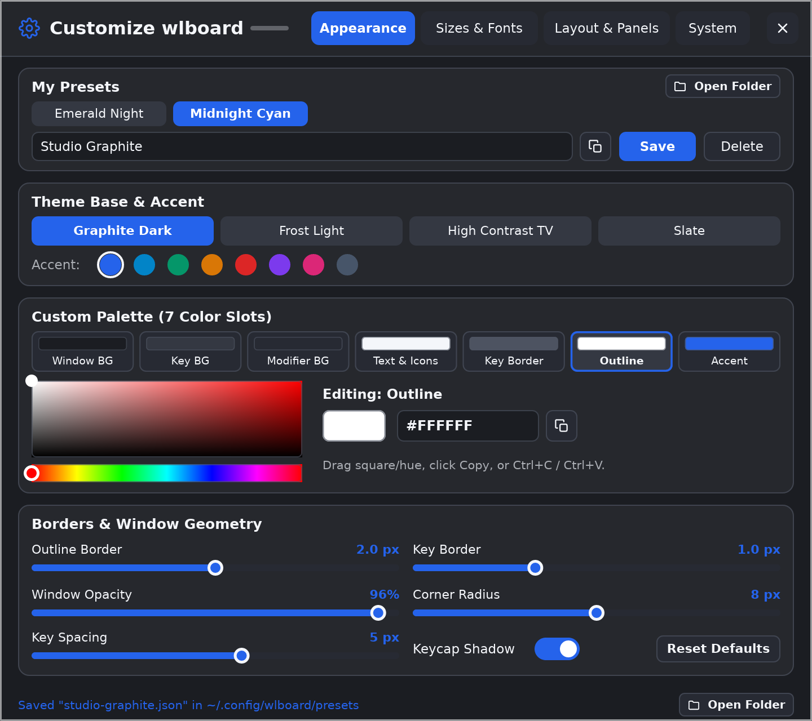
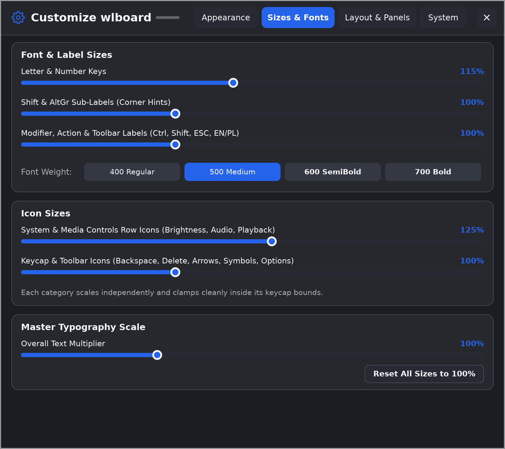
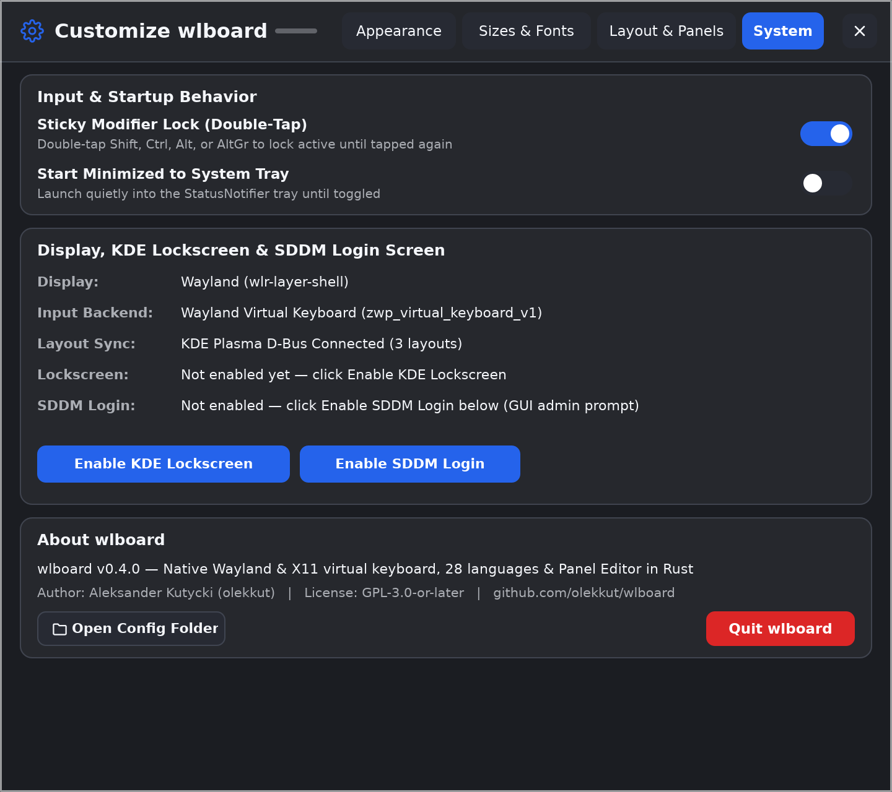
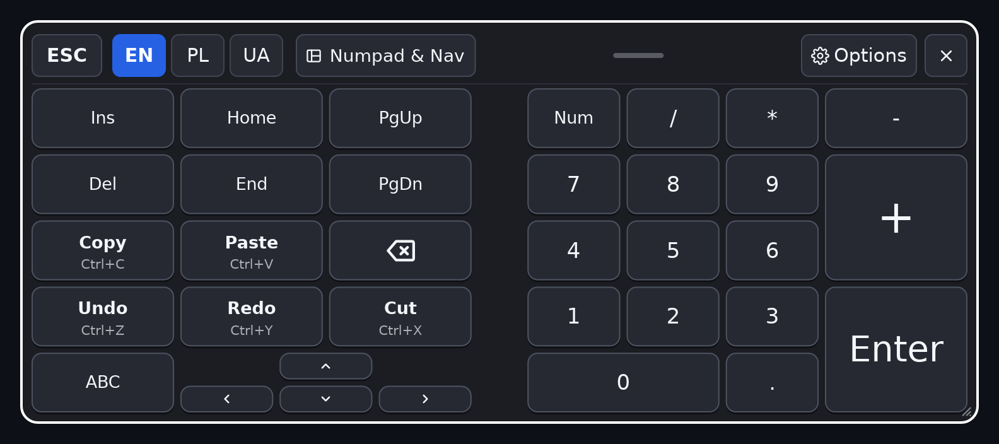
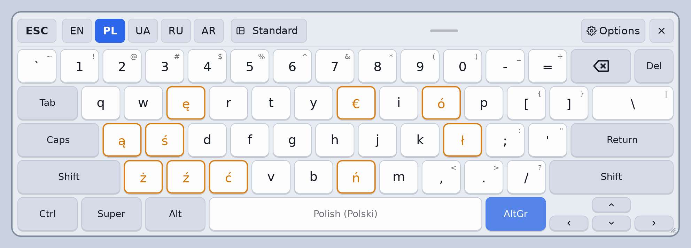
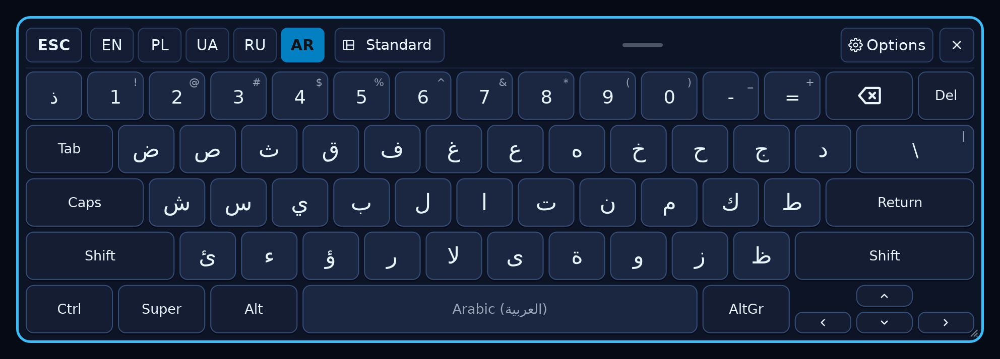

# wlboard

**wlboard** is a lightweight, zero-idle-wakeup, deeply customizable Wayland & X11 virtual keyboard and custom panel studio written in Rust.

Built directly on `smithay-client-toolkit`, `x11rb`, `tiny-skia`, `cosmic-text`, and `resvg`, it renders crisp anti-aliased keycaps and monochrome vector icons with zero GTK, Qt, or GPU-driver dependencies (`~11 MB` private RAM, `0 wakeups/sec` while idle).

## Highlights

- **Zero-Idle-Wakeup Event Loop (`0/s` at Idle)**: Strictly event-driven `calloop` epoll + blocking D-Bus worker with a dynamic one-shot timer armed only during active key repeat, held-key watchdog checks, or debounced config saves — letting laptop/tablet CPUs enter deep sleep C-states immediately.
- **Native Wayland + Ubuntu GNOME & X11 Auto-Fallback**:
  - **KDE Plasma / Hyprland / Sway (Wayland)**: Floating `zwlr_layer_shell_v1` overlay (`Layer::Overlay`, `KeyboardInteractivity::None`) that stays above windows without stealing focus, with smooth drag, 8-edge resize, and display-bounds clamping.
  - **Ubuntu GNOME & X11 Desktops**: Automatically switches to a pure-Rust `x11rb` 32-bit ARGB XWayland/X11 non-focus-stealing overlay (`WM_HINTS { input = False }`, `_NET_WM_STATE_ABOVE`, `STICKY`, `SKIP_TASKBAR`, `SKIP_PAGER`) whenever `zwlr_layer_shell_v1` is not advertised.
  - **Smart Single-Keyboard KDE Lockscreen & SDDM Login Screen**: `wlboard --input-method` (`zwp_input_method_v1` + `zwp_input_panel_v1`) checks `org.freedesktop.ScreenSaver.GetActive()` / greeter state so it **only** activates on Lockscreen or SDDM (never duplicating over the floating desktop keyboard), supports click-through drag/lift/resize, and includes **1-click Enable/Disable controls for both KDE Lockscreen and SDDM Login Screen** right inside **Customize wlboard → System**.
- **Granular `Sizes & Fonts` Tab**: Independently scale **Letter & Number Keys**, **Shift & AltGr Sub-Labels**, **Modifier/Action/Toolbar Labels**, **System & Media Controls Row Icons**, and **Keycap & Toolbar Icons** (`60%–180%`), plus Font Weight (`400–700`), Master Typography Scale, and 1-click Reset.
- **Clipboard Copy/Paste & File Manager Integration**: Full `Ctrl+A`, `Ctrl+C`, `Ctrl+X`, and `Ctrl+V` support with selection highlighting across every inline text field in Settings and Panel Editor, 1-click **Copy** buttons beside Preset Name and Hex Color inputs, and **Open Folder** (`xdg-open`) shortcuts for Presets, Custom Panels, Config, and the save status bar.
- **28 Built-in Languages + Searchable Add/Delete Language Manager**: Add, remove, or reorder any language directly inside **Customize wlboard → Layout & Panels** with HarfBuzz/BiDi shaping, optional AltGr amber diacritic hints, two-way KDE Plasma D-Bus sync, and automatic `kxkbrc` layout registration.
- **Built-in Visual Panel Editor (`0.5u` Snap Grid)**: Design, duplicate, and customize keyboard panels visually with drag-to-move, corner-handle resize, and a full Key Inspector supporting layout keys, fixed keys, multi-key shortcuts (`Ctrl+C`, `Alt+Tab`, `Super+D`), text snippets, panel switchers, and per-key color tints.
- **4 Starter Panels + Monochrome SVG Symbol Mode**: Switch instantly between **Standard** (half-height Inverted-T arrows + forward `Del`), **Compact TV** (`ABC` + `123` / `F1–F12` / Navigation), **Numpad & Nav**, and **Shortcuts & Media**, plus your own custom JSON panels (`~/.config/wlboard/panels/*.json`).
- **Draggable & 8-Edge Resizable Option Windows**: Drag either **Customize wlboard** or **Panel Editor** smoothly from its header bar or empty chrome, and resize from any edge or corner.

---

## Screenshots

### Graphite Dark — Standard Layout (Inverted-T Arrows, Forward `Del`, Monochrome SVG Symbols & Media Row)


### Built-in Settings — Appearance, HSV Color Slots, Copy & Open Folder


### Built-in Settings — Dedicated `Sizes & Fonts` Scaling Tab


### Built-in Settings — System, 1-Click KDE Lockscreen & SDDM Login Controls


### Built-in Settings — Layout, Panels & Active Languages Manager


### Built-in Settings — Searchable 28-Language Add / Remove Picker


### Built-in Visual Panel Editor (3-Pane `0.5u` Snap-Grid Studio)


### Starter Panels — Shortcuts & Media and Numpad & Nav



### Graphite Dark — Compact for TV (Ukrainian)


### Frost Light — Polish Layout with AltGr Amber Diacritic Hints


### Custom User Preset ("Midnight Cyan") — Arabic Layout


---

## Installation

### Ubuntu / Kubuntu / Debian (`.deb` Package — `amd64`)

Install the latest prebuilt `.deb` package (automatically installs the `/dev/uinput` udev rule, KDE Plasma virtual keyboard desktop entry, and SDDM helper):

```bash
curl -fsSL -o /tmp/wlboard.deb https://raw.githubusercontent.com/olekkut/wlboard/deb-build/wlboard_0.4.0-1_amd64.deb \
  && sudo apt install -y /tmp/wlboard.deb \
  && rm -f /tmp/wlboard.deb
```

### Build from Source

Requires Rust 1.89+ (`cargo`):

```bash
git clone https://github.com/olekkut/wlboard.git
cd wlboard
cargo build --release
sudo install -Dm755 target/release/wlboard /usr/bin/wlboard
sudo install -Dm755 packaging/deb/wlboard-im /usr/bin/wlboard-im
sudo install -Dm644 packaging/deb/io.github.olekkut.wlboard.desktop /usr/share/applications/io.github.olekkut.wlboard.desktop
sudo install -Dm644 packaging/deb/io.github.olekkut.wlboard-im.desktop /usr/share/applications/io.github.olekkut.wlboard-im.desktop
sudo install -Dm644 assets/io.github.olekkut.wlboard.svg /usr/share/icons/hicolor/scalable/apps/io.github.olekkut.wlboard.svg
```

On **KDE Plasma** or **Ubuntu GNOME** desktop (where `/dev/uinput` is used for virtual keystrokes), run once if you installed from source:

```bash
./packaging/deb/setup-uinput.sh
```

---

## KDE Plasma Lockscreen & SDDM Login Screen Setup

Both Lockscreen and SDDM login screen integration can be enabled or disabled directly inside **Customize wlboard → System** (`wlboard --settings`):

1. **KDE Plasma Lockscreen**: Click **Enable KDE Lockscreen (Mouse + Touch)** (or **Touch-Only** / **Disable**) — updates `~/.config/kwinrc` (`[Wayland]`) and `~/.config/environment.d/70-wlboard-kwin.conf` safely without affecting desktop typing. Log out and back in once, then lock your screen (`Super+L`) and click **Virtual Keyboard**.
2. **SDDM Wayland Login Screen**: Click **Enable SDDM Login** (or **Disable SDDM**) inside **Customize wlboard → System** to run `/usr/share/wlboard/scripts/setup-sddm.sh` via your desktop authentication dialog (`pkexec`), or run it directly from a terminal:

```bash
/usr/share/wlboard/scripts/setup-sddm.sh          # Enable
/usr/share/wlboard/scripts/setup-sddm.sh --remove # Revert cleanly
```

---

## Usage & CLI

| Command | Action |
|---|---|
| `wlboard` | Start `wlboard` floating overlay (or bring an existing instance to front) |
| `wlboard --toggle` | Toggle visibility (bind this to a panel button or compositor shortcut) |
| `wlboard --settings` | Open the built-in **Customize wlboard** window |
| `wlboard --panel-editor` | Open the built-in **Panel Editor** studio |
| `wlboard --panel <id>` | Switch active panel (`standard`, `compact_tv`, `numpad_nav`, `shortcuts_media`, or custom ID) |
| `wlboard --layout <code>` | Switch active language layout (any of the 28 built-in codes such as `en`, `pl`, `uk`, `ru`, `ar`, `de`, `fr`, `es`, `it`, `el`, `he`, `fa`, etc.) |
| `wlboard --input-method` | Run as a Wayland `zwp_input_method_v1` / `zwp_input_panel_v1` virtual keyboard (launched automatically by KWin on Lockscreen/SDDM) |
| `wlboard --hide` | Hide the floating overlay |
| `wlboard --quit` | Release all keys and exit cleanly |

### Configuration & User Data

- Settings file: `~/.config/wlboard/config.toml`
- Saved Custom Panels: `~/.config/wlboard/panels/*.json`
- Saved User Presets: `~/.config/wlboard/presets/*.json`
- Custom Layout Overrides: `~/.config/wlboard/layouts/*.json`

---

## Workspace Architecture

| Crate | Purpose |
|---|---|
| `crates/wlboard-core` | Pure Rust domain model: unified 2D `0.5u` snap-grid panel model, 4 starter panels + JSON `PanelStore`, 28 built-in international layouts + custom JSON overrides, modifier & Sticky Lock state machine, theme palette & granular typography/icon scaling, TOML config, JSON User Presets, multi-touch & 8-edge resize geometry |
| `crates/wlboard-platform` | OS & desktop adapters: `zwp_input_method_v1` direct Unicode/keysym backend, `zwp_virtual_keyboard_v1` + dynamic XKB keymap compiler, pure-Rust `evdev` uinput + watchdog, zero-idle-wakeup D-Bus worker, KDE Plasma layout sync & Lockscreen/SDDM setup helpers, `ScreenSaver.GetActive` guard, `xdg-open` folder helper, StatusNotifierItem tray, single-instance D-Bus IPC |
| `crates/wlboard-ui` | Unified `tiny-skia` + `cosmic-text` + `resvg` renderer, zero-idle-wakeup Wayland (`zwlr_layer_shell_v1` / `zwp_input_panel_v1`) and pure-Rust `x11rb` XWayland/X11 runtimes, clipboard bridge, draggable & resizable 3-pane visual Panel Editor, 4-tab `Customize wlboard` window, offline HiDPI PNG preview generator |
| `crates/wlboard-app` | Thin CLI binary (`wlboard`), logging, IPC dispatch, and zero-wakeup Unix signal-pipe shutdown |

---

## License

Copyright (C) 2026 Aleksander Kutycki (`olekkut`).

Licensed under the **GNU General Public License v3.0 or later** (`GPL-3.0-or-later`). See [LICENSE](LICENSE) for full terms.
